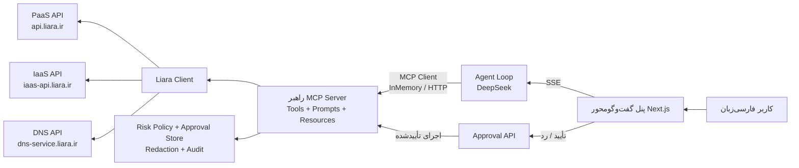
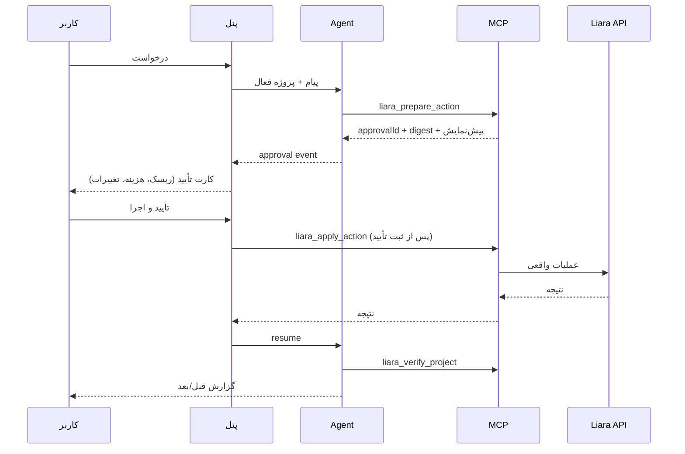

# راهبر | دستیار هوشمند زیرساخت لیارا

راهبر یک دستیار فارسی‌زبان برای صاحبان سایت است: از انتخاب پلن و اولین استقرار تا پایش، عیب‌یابی و اقدام اصلاحی. رابط کاربری یک گفت‌وگوی ساده است، اما پشت آن یک MCP واقعی برای لیارا اجرا می‌شود که همان قابلیت‌ها را در اختیار کلاینت‌های دیگر مثل Claude Desktop و Cursor هم می‌گذارد.

> چالش: دستیار هوشمند مدیریت وب‌سایت روی لیارا  
> خروجی: MVP قابل‌اجرا + MCP + پنل فارسی + مستندات + ویدئوی دمو (طبق صورت‌چالش)

---

## چه چیزی را حل می‌کند؟

کاربر غیرفنی نمی‌داند چه پلنی بخرد، سورس را چطور آپلود کند، چرا سایت ۵۰۰ می‌دهد یا دامنه چرا وصل نمی‌شود. راهبر:

1. وضعیت واقعی حساب و پروژه‌ها را از API لیارا می‌خواند.
2. گزینه‌های مناسب را با قیمت زنده و دلیل مقایسه می‌کند.
3. کارهایی که API اجازه می‌دهد را **خودش انجام می‌دهد**، اما قبل از اقدام حساس کارت تأیید نشان می‌دهد.
4. کارهایی که API اجازه نمی‌دهد (ایرنیک، پرداخت، SSH، تغییر کد) را با راهنمای دقیق به کاربر می‌سپارد.
5. بعد از اینکه کاربر نتیجه‌ی کار دستی را گزارش داد، با ابزار خواندنی بررسی می‌کند و ادامه می‌دهد.

### قاعده‌ی اصلی: سه سطح توانایی

| سطح | مثال | رفتار راهبر |
|---|---|---|
| خودش انجام می‌دهد | انتخاب پلن، ساخت برنامه، استقرار، ری‌استارت، تغییر پلن، دامنه در لیارا، بررسی DNS/SSL | گزینه‌ها + پیشنهاد + تأیید انسانی + اجرا + بررسی نتیجه |
| کاربر انجام می‌دهد، راهبر بررسی می‌کند | تغییر NS/رکورد در ایرنیک، شارژ حساب، SSH | راهنمای گام‌به‌گام + دکمه‌ی «انجام دادم؛ بررسی کن» + فراخوانی ابزار بررسی |
| کاربر انجام می‌دهد، راهبر نمی‌تواند ببیند | KYC، تغییر مالکیت دامنه، کار داخل سرور | بهترین چک‌لیست + درخواست گزارش نتیجه + ادامه‌ی مسیر بر اساس گزارش |

---

## شروع سریع

```bash
npm install
cp .env.example .env
# LIARA_API_KEY و LLM_API_KEY را در .env بگذارید
npm run dev
```

سپس [http://localhost:3000](http://localhost:3000) را باز کنید.

### متغیرهای محیطی

```dotenv
LIARA_API_KEY=...            # از کنسول لیارا
LIARA_TEAM_ID=               # اختیاری
LLM_BASE_URL=https://api.deepseek.com
LLM_API_KEY=...              # کلید مدل زبانی
LLM_MODEL=deepseek-flash
LLM_TEMPERATURE=0.3
LLM_MAX_TOKENS=8000
SYSTEM_PROMPT_PATH=          # پیش‌فرض: prompts/raahbar-system.md
APP_URL=http://localhost:3000
MCP_AUTH_TOKEN=              # برای محافظت از /api/mcp در حالت عمومی
DATA_DIR=.data
MAX_UPLOAD_MB=50
APPROVAL_SECRET=             # پیش‌فرض: LIARA_API_KEY
LIARA_MCP_ALLOW_LOCAL_PATHS=false
```

> این MVP برای اجرای محلی است. پنل لاگین ندارد و از یک کلید لیارای سمت سرور استفاده می‌کند. برای production باید احراز هویت، کلید اختصاصی هر کاربر و ذخیره‌سازی رمزنگاری‌شده اضافه شود.

---

## System Prompt

پرامپت اصلی agent در فایل [`prompts/raahbar-system.md`](prompts/raahbar-system.md) است و در هر درخواست خوانده می‌شود؛ بنابراین می‌توانید لحن، قواعد تأیید و رفتار دستی را بدون تغییر کد ویرایش کنید. مسیر جایگزین با `SYSTEM_PROMPT_PATH` قابل تنظیم است.

## معماری



- **یک پیاده‌سازی ابزار:** پنل و کلاینت‌های خارجی از همان MCP استفاده می‌کنند.
- **دو مرحله‌ای:** `liara_prepare_action` فقط پیش‌نمایش می‌سازد؛ `liara_apply_action` بدون تأیید انسانی اجرا نمی‌شود.
- **تصمیم انسانی خارج از دسترس مدل:** ابزار MCP برای «تأیید کردن» وجود ندارد؛ تأیید فقط از API پنل انجام می‌شود.
- **تشخیص قطعی:** موتور diagnóstico شواهد (لاگ، متریک، release، دامنه) را جمع می‌کند و مدل فقط آن را اولویت‌بندی و توضیح می‌دهد.

---

## اتصال به MCP

### Stdio (Claude Desktop / Cursor)

```json
{
  "mcpServers": {
    "raahbar-liara": {
      "command": "npx",
      "args": ["tsx", "/absolute/path/to/liara/src/mcp/stdio.ts"]
    }
  }
}
```

`stdio.ts` خودش ریشه‌ی پروژه را پیدا می‌کند، `.env` را می‌خواند و `.data` را همان‌جا می‌سازد. برای استقرار از مسیر محلی، `LIARA_MCP_ALLOW_LOCAL_PATHS=true` و در صورت نیاز `LIARA_MCP_SOURCE_ROOT` را تنظیم کنید.

### Streamable HTTP

```bash
curl -N -X POST http://localhost:3000/api/mcp \
  -H 'content-type: application/json' \
  -H 'accept: application/json, text/event-stream' \
  -H 'mcp-protocol-version: 2025-06-18' \
  -d '{"jsonrpc":"2.0","id":1,"method":"initialize","params":{"protocolVersion":"2025-06-18","capabilities":{},"clientInfo":{"name":"curl","version":"1"}}}'
```

اگر `MCP_AUTH_TOKEN` تنظیم شود، هدر `Authorization: Bearer ...` لازم است.

### ابزارهای MCP

- خواندنی: `liara_account`, `liara_list_projects`, `liara_get_project`, `liara_list_plans`, `liara_recommend_plan`, `liara_app_logs`, `liara_app_metrics`, `liara_app_releases`, `liara_app_events`, `liara_diagnose_app`, `liara_verify_project`, `liara_wait_release`, `liara_list_domains`, `liara_check_domain`, `liara_list_vms`, `liara_vm_plans`, `liara_vm_os`, `liara_list_databases`, `liara_get_guide`
- دو مرحله‌ای: `liara_prepare_action`, `liara_apply_action`, `liara_action_status`, `liara_cancel_action`
- Promptها: `deploy-new-app`, `choose-plan`, `troubleshoot-500`, `slow-site`, `connect-domain`, `what-can-you-do`
- Resourceها: `liara://guides`, `liara://guides/{topic}`, `liara://account`

---

## جریان تأیید انسانی



- `medium` / `high`: کارت تأیید با هزینه و هشدار.
- `critical` (حذف برنامه/VM): تایپ دقیق نام منبع.
- تأیید ۱۰ دقیقه اعتبار دارد، یک‌بارمصرف است و به digest پارامترها گره خورده است.
- لاگ audit در `.data/audit.jsonl` ذخیره می‌شود.

---

## Liara API

| سرویس | Base URL |
|---|---|
| PaaS / DBaaS / حساب | `https://api.liara.ir` |
| IaaS (VM) | `https://iaas-api.liara.ir` |
| DNS | `https://dns-service.liara.ir` |

احراز هویت: `Authorization: Bearer <LIARA_API_KEY>`.

نکته‌های مهم:

- پلن‌ها از `GET /v1/me` خوانده می‌شوند (`plans.projects` و `plans.projectBundlePlans`).
- **قیمت بسته‌ی امکانات، قیمت کل پلن + بسته است؛ آن را با قیمت پلن جمع نکنید.**
- ساخت برنامه: `POST /v1/projects` با `{ name, planID, platform, bundlePlanID }`.
- آپلود سورس: `POST /v2/projects/{app}/sources` (فایل `.tar.gz`).
- استقرار: `POST /v2/projects/{app}/releases` با `sourceID`.
- وضعیت بیلد: `GET /v1/releases/{id}` و `GET /v2/releases/{id}/build-logs`.
- لاگ: `GET /v2/projects/{app}/logs`.
- متریک: `GET /v1/projects/{app}/metrics/...`.
- نقاط کلیدی VM و دامنه در `docs/PLAN.md` آمده است.

اگر موجودی حساب کم باشد، ساخت/استقرار ممکن است `402` یا `g2_plan_unavailable` بدهد. راهبر این را به‌عنوان محدودیت پرداخت/دسترسی پلن توضیح می‌دهد، راهنمای billing را می‌دهد و ادعا نمی‌کند برنامه ساخته شده است.

---

## محدودیت‌ها (شفاف)

- تغییر رکورد در ایرنیک یا registrar از طریق API لیارا ممکن نیست؛ راهبر رکوردهای دقیق را می‌دهد و بعد از گزارش کاربر با API بررسی می‌کند.
- پرداخت، شارژ، فاکتور و KYC فقط در کنسول لیارا انجام می‌شود.
- Rollback خودکار در API عمومی مستند نشده است؛ راهکار، استقرار مجدد از سورس/نسخه‌ی سالم است.
- SSH و عملیات داخل VM از این MVP خارج است.
- لاگ و متریک به بازه‌ی نگه‌داری بسته‌ی امکانات محدود است.
- پنل برای دموی محلی احراز هویت ندارد. کلید لیارا فقط سمت سرور است.
- نرخ محدودیت API مستند نیست؛ کلاینت GETها را با backoff دوباره تلاش می‌کند.
- **موجودی حساب دمو کم است** (در زمان ساخت این پروژه ۳۰۲.۸۹ و حداقل اعتبار ۳۰۰۰)؛ برای ویدئوی دموی واقعی، حساب را شارژ کنید یا از پروژه‌ی موجود استفاده کنید.

---

## تست و کیفیت

```bash
npm run typecheck
npm run lint
npm test
npm run build
```

- تست‌های واحد: پلن، تشخیص، تأیید دو مرحله‌ای.
- Smoke واقعی خواندنی: `npx tsx scripts/smoke.ts` (نیاز به `.env`).
- Smoke HTTP MCP: `npx tsx scripts/smoke-http.ts`.
- Smoke stdio MCP: `npx tsx scripts/smoke-stdio.ts`.
- برای تست نوشتن واقعی، حساب باید اعتبار کافی داشته باشد؛ اسکریپت عمداً اقدام مالی انجام نمی‌دهد.

---

## ساختار پروژه

```
src/app/api/chat          Agent loop + SSE
src/app/api/approvals     تصمیم انسانی + اجرا
src/app/api/mcp           Streamable HTTP MCP
src/app/api/sources       آپلود امن و بسته‌بندی
prompts/raahbar-system.md  System prompt قابل ویرایش agent
src/lib/agent             Prompt loader، session، loop
src/lib/mcp               Server، tools، actions
src/lib/liara             Client، plans، diagnostics
src/lib/security          Risk، approval، redaction، audit
src/lib/guides            راهنماهای فارسی
src/components            پنل RTL
docs/PLAN.md               مستند معماری و محدودیت‌ها
docs/DEMO.md               سناریوی ویدئوی ۵ دقیقه‌ای
demo/sample-site           سایت نمونه برای استقرار
```

---

## دمو

سناریوی کامل ۵ دقیقه‌ای در [docs/DEMO.md](docs/DEMO.md) و فیلم‌نامه‌ی ۳ دقیقه‌ای در [video-script.md](video-script.md) قرار دارد. برای ساخت آرشیو نمونه:

```bash
tar -czf demo-site.tar.gz -C demo/sample-site .
```

سپس فایل `demo-site.tar.gz` را در پنل آپلود کنید.

---

## اعتبار

ساخته‌شده برای چالش «دستیار هوشمند مدیریت وب‌سایت روی لیارا». طراحی و متن فارسی با الهام از قواعد fordi-skill در همین مخزن.
